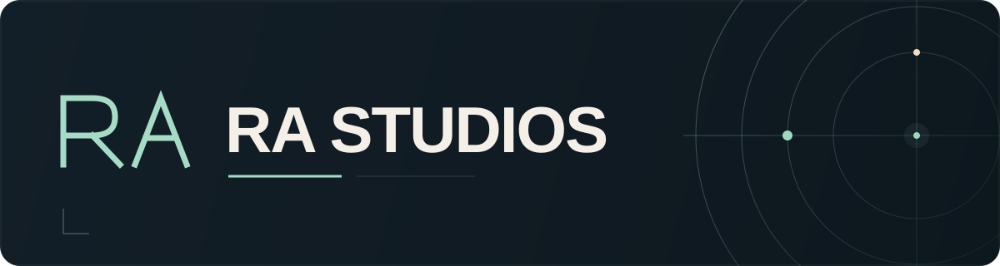

  

  <strong>Thoughtful interfaces. Useful software.</strong> 
  Web experiences, applied AI, and typography.

  <a href="https://rastudios.site">Website</a> &nbsp;·&nbsp;
  <a href="https://github.com/Ra-Studios?tab=repositories">All projects</a> &nbsp;·&nbsp;
  <a href="https://github.com/Ra-Studios/Font_Styles">Font archive</a>

---

## Computer science, with a creative edge.

I'm a computer science student building at the intersection of software, design, and data. Ra Studios brings that work together: interfaces that make information easier to use, experiments in machine learning, and resources for creative projects.

My focus is on **clear interaction**, **responsive interfaces**, and **learning by building**.

## Selected work

### 01 · AI Data Analyzer

A local data-analysis workspace for exploring datasets, forecasting trends, clustering, and classification. A React interface brings the analysis together with a Python API.

React · Vite · Python · FastAPI

[Explore the project →](https://github.com/Ra-Studios/AI-Data-Analyzer)

### 02 · Interactive Web Dashboard

A responsive dashboard with interactive charts, KPI cards, and a paginated data table. Includes light and dark themes, collapsible navigation, and keyboard shortcuts.

JavaScript · HTML · CSS · Chart.js

[Explore the project →](https://github.com/Ra-Studios/interactive-web-dasbord)

### 03 · Font Styles Archive

An alphabetically organized collection of typography packages gathered from open-source repositories, with a searchable folder index and archive assembly instructions. The fonts remain the work of their original creators; their individual licenses apply.

Typography · Curation · Design resources

[Browse the archive →](https://github.com/Ra-Studios/Font_Styles)

## Tools I work with

**Web** &nbsp; `JavaScript` `HTML` `CSS` `React` `Vite`

**Data & AI** &nbsp; `Python` `FastAPI` `Machine learning` `Data visualization`

**Design & workflow** &nbsp; `Figma` `Typography` `Git` `GitHub` `VS Code`

## What guides the work

- **Clarity first.** Give each screen a clear purpose and make the next action easy to find.
- **Details matter.** Treat spacing, typography, accessibility, and smaller screens as part of the design.
- **Keep learning.** Explore ideas through working projects and explain how they fit together.

---

  <strong>Explore the work. Follow what comes next.</strong> 
  <a href="https://github.com/Ra-Studios?tab=repositories">Browse repositories</a> &nbsp;·&nbsp;
  <a href="https://github.com/Ra-Studios">Ra Studios on GitHub</a>

